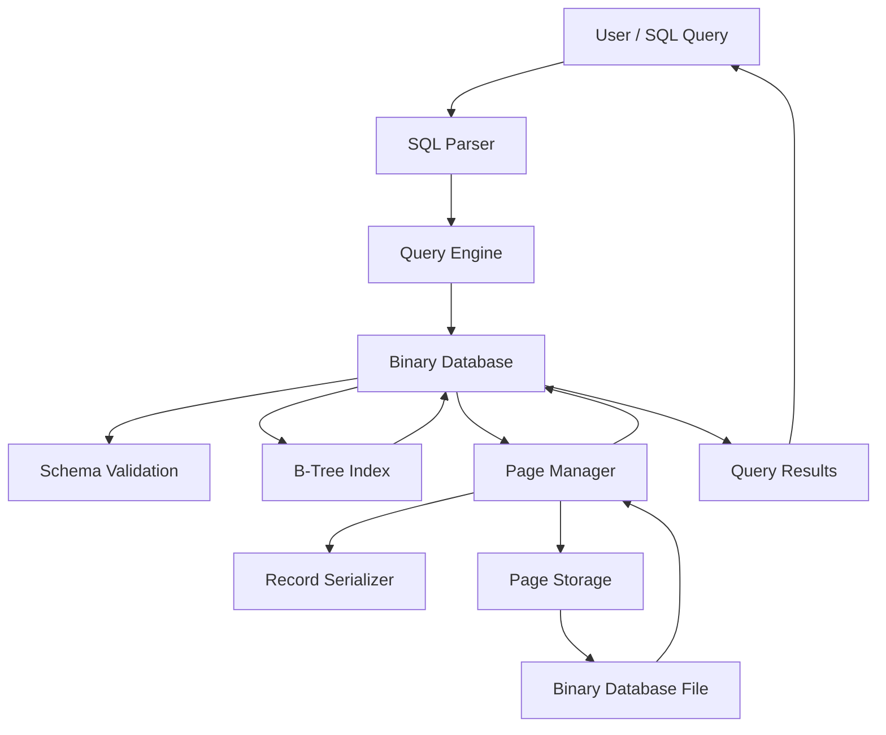

# Python Database Engine — System Architecture

## 1. Architecture Overview

The Python Database Engine processes SQL queries and stores records in a custom binary database.

## 2. System Architecture Diagram

## 3. Component Description

| Component | Responsibility |
|---|---|
| SQL Parser | Parses supported SQL statements |
| Query Engine | Routes parsed operations to the database |
| Binary Database | Manages database operations and schema |
| B-Tree | Provides primary-key indexing and lookup |
| Page Manager | Manages fixed-size database pages and records |
| Record Serializer | Converts records into binary representation and back |
| Page Storage | Reads and writes database pages |
| Metadata | Stores table schemas in JSON files |

## 4. Query Execution Flow

1. The user submits an SQL query.
2. The SQL Parser identifies the operation and extracts its parameters.
3. The Query Engine receives the parsed query.
4. The Binary Database performs validation and executes the requested operation.
5. The Page Manager accesses the required database pages.
6. The Record Serializer handles binary record conversion.
7. The B-Tree index supports primary-key searches.
8. The query result is returned to the user.

## 5. Storage Architecture

- Database records are stored in binary files.
- Database pages use a fixed size of 4096 bytes.
- Table schema metadata is stored separately in JSON files.
- Primary-key indexes are rebuilt from stored records when the database is reopened.

## 6. Design Objective

The objective is to understand and implement fundamental database management concepts, including query processing, binary storage, page management, serialization, indexing, and persistence.